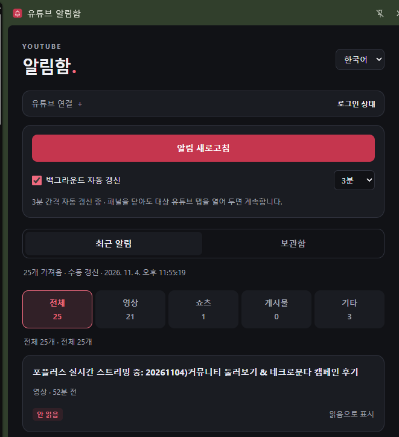

[한국어](README.md) | [English](README.en.md)

YouTube Notification Organizer — Building a Chrome Extension with AI

A personal Chrome extension project for organizing YouTube notifications in a side panel, managing local read/unread indicators, and keeping a browser-local archive.

This project began with inconveniences I encountered while using YouTube. It was developed through vibe coding: defining requirements in natural language, collaborating with an AI coding tool, and refining the implementation through hands-on testing.

This repository documents the project’s goals, features, implementation, and limitations.

Background

YouTube’s notification list combines different types of activity, including video uploads, Shorts, posts, and comment replies. I wanted a way to separate these notifications, track which ones I had checked, and retain items for later reference.

The project was built around the following goals:

Display notifications in a side panel alongside YouTube.

Categorize notifications and manage local read/unread indicators.

Separate the latest collected list from an accumulated archive.

Provide manual refresh and optional automatic refresh.

Operate without a separate backend server or external database.

Development Approach: Vibe Coding with AI

The project was developed with OpenAI Codex.

Rather than implementing every feature at once, I described requirements in natural language, started with small pieces of functionality, and repeatedly checked the results in Chrome.

The main development stages were:

Checking the sign-in state of an existing YouTube tab.

Collecting notifications and displaying them in a side panel.

Adding optional background refresh and configurable intervals.

Fixing cases where YouTube’s notification menu remained open after collection.

Categorizing notifications and handling comment destination links.

Adding local read/unread indicators.

Improving the interface and adding Korean, English, and Japanese UI options.

Separating recent notifications from an accumulated archive.

AI assisted with code generation, revisions, and verification. I defined the intended behavior, prioritized features, and checked the results during actual use. Screenshots and reproducible scenarios were used to explain problems and review fixes.

For this project, vibe coding was an iterative process of requirements → implementation → hands-on testing → feedback → revision.

Features

Feature / Implementation

Side panel / Displays notifications in Chrome’s side panel

Categories / All, Videos, Shorts, Posts, and Other, with item counts

Navigation / Opens notification links in a new tab

Read/unread indicators / Tracks local status and allows manual changes

Recent notifications / Displays the most recently collected list

Archive / Accumulates collected notifications with deduplication

Retention settings / 7, 30, or 90 days from first collection, up to 1,000 entries

Refresh settings / Manual by default, with optional 3, 5, 10, 30, or 60-minute automatic refresh

UI languages / Korean, English, and Japanese

Categorization relies on available destination links and related information. Some notifications may therefore be classified incorrectly.

Architecture

The extension uses Chrome Manifest V3.

Component / Responsibility

Side Panel / Notification display, filtering, read/unread controls, and settings

Service Worker / Coordinates collection jobs and scheduled refresh

Page-executed code / Checks sign-in state and collects notifications from YouTube

Chrome Storage / Stores settings, read indicators, recent results, and archived entries

Chrome Alarms / Schedules the user-selected automatic refresh interval

Automatic refresh is handled through Chrome’s scheduled events rather than keeping the service worker continuously active.

Collection Method

The extension operates in an existing desktop YouTube tab where the user is already signed in.

During refresh, it executes code in the page, opens YouTube’s notification menu, and reads notification text, destination links, notification IDs, and other relevant fields from loaded notification elements and their associated internal page data.

It does not use the official YouTube Data API or OAuth. Opening the notification menu may cause YouTube’s own page to make normal network requests using the existing signed-in session. It may also clear YouTube’s new-notification indicator.

The extension reads up to 100 currently loaded notifications. It does not automatically scroll through the entire notification history or retrieve notifications retroactively.

Local Storage and Privacy

The extension does not use a separate backend server, external database, or analytics service. Collected notifications and settings are not transmitted to a developer-operated server. The extension does not directly read cookies, authentication tokens, or passwords.

Notification text may nevertheless contain other users’ display names or comment excerpts, so locally stored records may include personal information.

Recent notifications: Stored in Chrome session storage and replaced after refresh.

Archive: Stored locally, with a default retention period of 30 days and a limit of 1,000 entries.

Read indicators and settings: Stored locally within the Chrome profile.

Expired archive entries are cleaned up when the archive is accessed, notifications are collected, or retention settings change. Per-notification local read indicators currently have no separate automatic expiration rule.

Data is currently stored per Chrome profile, rather than separately for each YouTube account.

Interface Behavior

Categories and Read/Unread Indicators

Users can switch between notification categories and change each item’s local read/unread status.

These indicators are managed by the extension and are separate from YouTube’s own read status.

Recent Notifications and Archive

Recent notifications show the latest collection result. The archive accumulates notifications from the time they are first collected.

Archive dates represent when the extension first saved an item, rather than when the notification originally occurred on YouTube.

Automatic Refresh

Refresh is manual by default. Users can explicitly enable automatic refresh and select an interval.

The selected YouTube tab must remain open for automatic refresh to work.

Verification

Development included automated tests and manual checks in Chrome.

Checks covered notification collection, comment navigation, closing the notification menu after automatic refresh, categorization, read/unread indicators, language switching, and archive behavior.

These checks do not guarantee correct operation across every account, language, or browser state.

Known Limitations

Changes to YouTube’s page structure or internal data formats may break collection.

Some notifications may lack a usable destination link or may be categorized incorrectly.

Links to deleted comments may no longer lead to accessible content.

Automatic refresh requires the selected YouTube tab to remain open.

Browser shutdown, system sleep, and tab suspension may interrupt or delay refresh.

During personal use, automatic refresh has sometimes failed when multiple YouTube tabs were open. Manually refreshing from the intended tab may help by selecting it again as the target.

Stored data is not separated by YouTube account. Using multiple accounts within the same Chrome profile may mix archived notifications.

Project Status and Scope

This project was created to address a personal inconvenience and explore development with AI coding tools. This repository shares its features, interface, and development notes.

I contacted YouTube about the current access method but have not received a response as of this writing. Submission of an inquiry or the absence of a response is not treated as permission to use or distribute the implementation.

This is an independent project and is not affiliated with, endorsed by, or approved by YouTube or Google. If YouTube or Google requests that its use stop under applicable policies or terms, I will discontinue use and take the necessary action.

The extension is not distributed.
