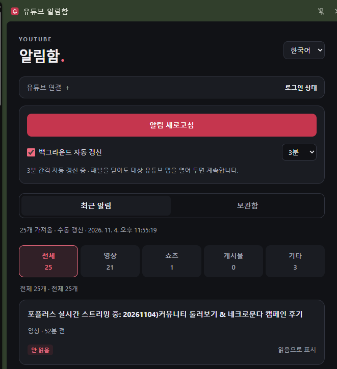

[한국어](README.md) | [English](README.en.md)

유튜브 알림함 — AI를 활용한 Chrome 확장 프로그램 개발 기록

YouTube 알림을 Chrome 사이드 패널에서 분류하고, 읽음 상태와 보관 목록을 관리하는 개인 개발 프로젝트입니다.

YouTube를 사용하면서 느낀 불편함을 출발점으로, 필요한 기능을 정의하고 AI 코딩 도구와 대화하며 구현하는 바이브 코딩(Vibe Coding) 방식으로 개발했습니다. 이 저장소는 개발 목적과 구현 내용, 동작 방식 및 한계를 기록하기 위한 공간입니다.

개발 배경

YouTube 알림 목록에는 영상 업로드, 쇼츠, 게시물, 댓글 답변 등 성격이 다른 항목이 함께 표시됩니다. 개인적으로는 원하는 종류의 알림을 구분하고, 확인 여부를 관리하며, 나중에 다시 볼 항목을 보관하는 기능이 필요했습니다.

이를 해결하기 위해 다음 목표를 설정했습니다.

영상 시청 화면과 함께 사용할 수 있는 사이드 패널 구성

알림 유형별 분류와 로컬 읽음 상태 관리

최근 목록과 누적 보관함 분리

사용자가 선택하는 수동·자동 갱신

별도 서버와 외부 데이터베이스 없이 동작하는 구조

개발 방식: AI를 활용한 바이브 코딩

개발에는 AI 코딩 도구인 OpenAI Codex를 활용했습니다.

처음부터 전체 기능을 한 번에 구현하기보다, 자연어로 요구사항을 설명하고 작은 기능부터 구현한 뒤 실제 Chrome 환경에서 확인하는 과정을 반복했습니다.

주요 진행 과정은 다음과 같습니다.

로그인된 YouTube 페이지의 로그인 상태 확인

실제 알림 목록 수집과 사이드 패널 표시

선택적 백그라운드 자동 갱신과 주기 설정

수집 후 YouTube 알림 메뉴가 남아 있는 문제 수정

알림 유형별 분류와 댓글 이동 링크 처리

로컬 읽음·안 읽음 표시

한국어·영어·일본어 UI와 화면 디자인 개선

최근 알림과 누적 보관함 분리

AI가 코드 작성과 수정, 검증 작업을 지원하고, 개발자는 기능의 필요성과 우선순위를 결정하며 실제 사용 결과를 확인하는 방식으로 진행했습니다. 화면 캡처와 재현 상황을 바탕으로 문제를 설명하고 수정 결과를 다시 확인하는 과정도 포함했습니다.

이 프로젝트에서 바이브 코딩은 단순히 코드를 생성하는 작업보다, 요구사항 정의 → 구현 → 실제 사용 → 피드백 → 수정을 반복하는 개발 과정에 가까웠습니다.

주요 기능

기능 / 구현 내용

사이드 패널 / Chrome 우측 패널에서 알림 목록 표시

알림 분류 / 전체·영상·쇼츠·게시물·기타 분류와 항목 수 표시

링크 이동 / 알림 제목을 선택하면 새 탭에서 열기

읽음 관리 / 로컬 읽음·안 읽음 표시 및 수동 변경

최근 알림 / 마지막으로 수집한 목록 표시

보관함 / 수집한 알림의 중복을 제거하여 누적 저장

보관 설정 / 최초 수집일부터 7·30·90일, 최대 1,000개 보관

갱신 설정 / 기본 수동 갱신, 선택적 3·5·10·30·60분 자동 갱신

다국어 UI / 한국어·영어·일본어 선택

알림 분류는 제공되는 이동 링크 등을 기준으로 처리합니다. 따라서 링크 형식에 따라 일부 항목의 분류가 정확하지 않을 수 있습니다.

시스템 구성

Chrome Manifest V3 기반으로 구성했으며, 주요 구성 요소의 역할은 다음과 같습니다.

구성 요소 / 역할

Side Panel / 알림 표시, 분류, 읽음 관리 및 설정

Service Worker / 수집 작업 조정과 자동 갱신 예약 처리

페이지 실행 코드 / YouTube 페이지의 로그인 상태 확인 및 알림 수집

Chrome Storage / 설정, 읽음 표시, 최근 목록과 보관함 저장

Chrome Alarms / 사용자가 선택한 주기의 자동 갱신 예약

자동 갱신은 서비스 워커를 계속 실행해 두는 방식이 아니라, Chrome의 예약 이벤트를 처리하는 구조입니다.

알림 수집 방식

사용자가 이미 로그인해 둔 PC용 YouTube 탭에서 동작합니다.

갱신을 실행하면 페이지에서 코드를 실행하여 YouTube 알림 메뉴를 열고, 현재 로드된 알림 요소와 연결된 페이지 내부 데이터에서 알림 내용·이동 링크·알림 ID 등을 읽습니다.

공식 YouTube Data API나 OAuth를 이용하는 방식은 아닙니다. 알림 메뉴를 여는 과정에서 YouTube 페이지 자체가 기존 로그인 세션으로 통상적인 네트워크 요청을 보낼 수 있으며, YouTube의 새 알림 표시가 확인 처리될 수도 있습니다.

수집 대상은 현재 로드된 알림 중 최대 100개입니다. 전체 과거 알림을 가져오기 위한 자동 스크롤이나 소급 수집은 구현하지 않았습니다.

데이터 저장과 개인정보

별도 서버, 외부 데이터베이스 및 분석 서비스는 사용하지 않습니다. 수집한 알림과 설정을 개발자 서버로 전송하지 않으며, 확장 프로그램이 쿠키·인증 토큰·비밀번호를 직접 읽지는 않습니다.

다만 알림 내용에는 타인의 표시 이름이나 댓글 일부가 포함될 수 있으므로, 로컬에 저장되는 데이터에도 개인정보가 포함될 가능성이 있습니다.

최근 목록: Chrome 세션 저장소에 보관하며 갱신할 때 교체

보관함: 로컬 저장소에 기본 30일, 최대 1,000개 보관

읽음 표시와 설정: Chrome 프로필의 로컬 저장소에 저장

보관 기간이 지난 항목은 보관함 조회, 알림 수집 또는 보관 기간 변경 시 정리합니다. 알림 ID별 로컬 읽음 표시에는 현재 별도 자동 만료 규칙이 없습니다.

현재 데이터는 YouTube 계정별로 분리되지 않고 Chrome 프로필 단위로 저장됩니다.

사용 화면

알림 분류 및 읽음 관리

알림 종류별로 목록을 전환하고, 각 항목의 읽음 상태를 확인하거나 변경할 수 있습니다. 로컬 읽음 표시는 YouTube 자체의 읽음 상태와 별도로 관리합니다.

최근 알림 및 보관함

최근 알림은 마지막 수집 결과를 표시하고, 보관함은 수집한 시점부터 알림을 누적합니다. 보관함의 날짜는 YouTube 알림 발생 시각이 아니라 확장 프로그램에서 처음 저장한 시각을 기준으로 합니다.

자동 갱신 설정

기본은 수동 갱신이며, 자동 갱신은 사용자가 직접 활성화합니다. 선택한 대상 YouTube 탭이 열려 있어야 동작합니다.

검증 과정

기능별 자동화 테스트와 실제 Chrome 환경에서의 수동 확인을 함께 진행했습니다.

알림 수집 결과, 댓글 링크 이동, 자동 갱신 후 메뉴 닫기, 분류·읽음 표시, 언어 전환 및 보관함 동작 등을 확인했습니다. 다만 이러한 검증이 모든 계정·언어·브라우저 상태에서의 동작을 보장하는 것은 아닙니다.

알려진 제약

- YouTube 화면 구조와 내부 데이터 형식이 변경되면 수집 기능이 작동하지 않을 수 있습니다.

- 일부 알림은 이동 링크를 확인하지 못하거나 정확히 분류하지 못할 수 있습니다.

- 삭제된 댓글 등은 링크를 열어도 해당 내용을 확인하지 못할 수 있습니다.

- 자동 갱신에는 대상 YouTube 탭이 열려 있어야 합니다.

- Chrome 종료, PC 절전, 탭 절전 등에 따라 갱신이 중단되거나 지연될 수 있습니다.

- 사용 중 YouTube를 여러 탭에 열어 둔 경우 자동 갱신이 정상적으로 동작하지 않는 상황이 있었습니다. 이 경우 사용할 탭에서 수동 갱신하여 대상을 다시 지정해 볼 수 있습니다.

- 저장 데이터가 YouTube 계정별로 분리되지 않아 같은 Chrome 프로필에서 여러 계정을 사용하면 보관 목록이 섞일 수 있습니다.

프로젝트 상태 및 공개 범위

개인적인 불편함을 해결하고 AI를 활용한 개발 과정을 경험하기 위해 제작한 프로젝트입니다. 이 저장소에서는 기능 소개, 화면 및 개발 기록을 공유합니다.

현재 구현 방식에 대해 YouTube에 문의했으나, 이 문서 작성 시점까지 별도의 답변을 받지 못했습니다. 문의 접수나 무응답을 사용·배포 허가로 해석하지 않습니다.

YouTube 또는 Google과 제휴하거나 승인을 받은 공식 제품이 아닙니다. 관련 정책이나 이용약관에 따른 중단 요청을 받는 경우, 사용을 중단하고 필요한 조치를 취하겠습니다.

확장 프로그램은 배포하지 않습니다.
